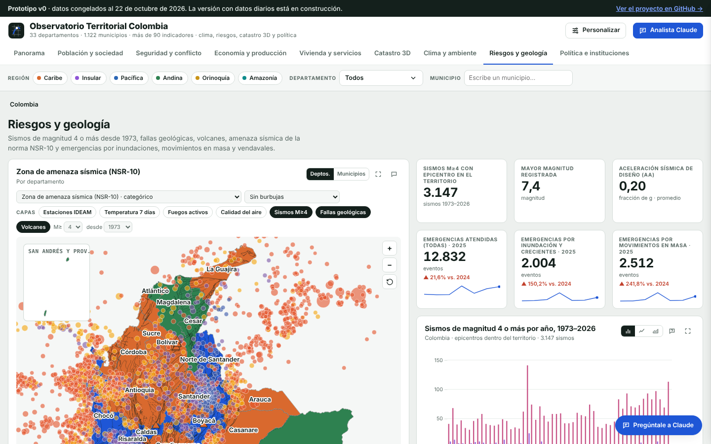
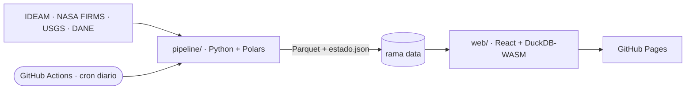

# Observatorio Territorial Colombia

[](https://github.com/AndresGarcia-15/observatorio-colombia/actions/workflows/ci.yml)
[](https://github.com/AndresGarcia-15/observatorio-colombia/actions/workflows/pipeline.yml)
[](LICENSE)

Tablero territorial de Colombia que se actualiza solo. Un pipeline en Python descarga cada mañana los datos abiertos del IDEAM, la NASA, el USGS y el DANE, los valida, los ubica en sus 1.122 municipios y los publica como Parquet. Una aplicación web estática los consulta directamente en el navegador.

> *A self-updating territorial dashboard for Colombia: a daily Python pipeline turns official open data into Parquet files that a static web app queries in the browser.*

**[Ver el prototipo en vivo →](https://andresgarcia-15.github.io/observatorio-colombia/)**



## Qué hace

- **Datos que se renuevan solos.** GitHub Actions ejecuta el pipeline todos los días a las 6:17 a. m. (hora de Colombia) y publica el resultado en la rama [`data`](../../tree/data).
- **Todo ubicado por municipio.** Sismos, fuegos y estaciones meteorológicas se asignan a su código DIVIPOLA con los polígonos del Marco Geoestadístico Nacional.
- **Control de calidad visible.** Los sensores dañados no se borran: cada dato lleva una marca `qc` con el motivo si es sospechoso.
- **Transparencia sobre la frescura.** `estado.json` registra cuándo se revisó cada fuente, cuándo cambió por última vez y qué periodo cubre.
- **Sin servidores.** Todo es estático y gratuito: GitHub Actions, GitHub Pages y DuckDB-WASM en el navegador.

## Fuentes en el pipeline

| Datos | Entidad | Actualización |
|---|---|---|
| Temperatura diaria por estación | IDEAM | diaria |
| Lluvia diaria por estación | IDEAM | diaria |
| Fuegos activos (VIIRS) | NASA FIRMS | varias veces al día |
| Sismos de magnitud 4 o más desde 1973 | USGS | tiempo real |
| Límites municipales | DANE (MGN) | anual |

El catálogo completo, con las fuentes que se van incorporando, está en [`docs/FUENTES.md`](docs/FUENTES.md).

## Arquitectura



Los detalles y las decisiones de diseño están en [`docs/ARQUITECTURA.md`](docs/ARQUITECTURA.md).

## Estructura

```
pipeline/     descarga, validación y publicación de datos (Python 3.13, uv, Polars, Shapely)
web/          aplicación web (fase 3: React, TypeScript, MapLibre, deck.gl, DuckDB-WASM)
prototype/    prototipo v0 en un solo archivo HTML
docs/         arquitectura, fuentes, diccionario de datos y hoja de ruta
.github/      CI, pipeline diario y despliegue en GitHub Pages
```

## Correr el pipeline en local

Requiere [uv](https://docs.astral.sh/uv/) (`brew install uv`).

```bash
cd pipeline
uv sync
uv run observatorio run          # descarga todas las fuentes en ../data
uv run observatorio status       # estado de cada fuente
uv run pytest                    # pruebas
```

Para recargar historia: `uv run observatorio run ideam-temperatura --desde 2024-01-01`.

Los datos publicados también se pueden consultar sin instalar nada, con DuckDB:

```sql
SELECT * FROM read_parquet('https://raw.githubusercontent.com/AndresGarcia-15/observatorio-colombia/data/sismos/usgs/2026.parquet');
```

## Hoja de ruta

El proyecto avanza por fases: prototipo, base del repositorio, pipeline, aplicación web, 3D y modo reto, y calidad. El detalle está en [`docs/ROADMAP.md`](docs/ROADMAP.md).

## Licencia

El código se publica con licencia [MIT](LICENSE). Los datos conservan la licencia de cada entidad (CC BY-SA 4.0 para datos.gov.co, dominio público para el USGS y cita obligatoria para NASA FIRMS). Ver [`docs/FUENTES.md`](docs/FUENTES.md).
