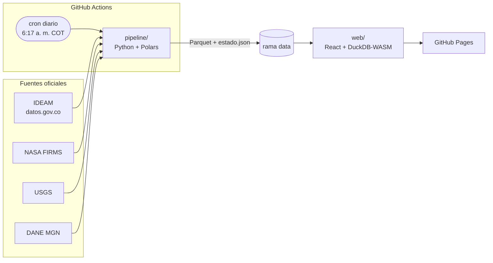
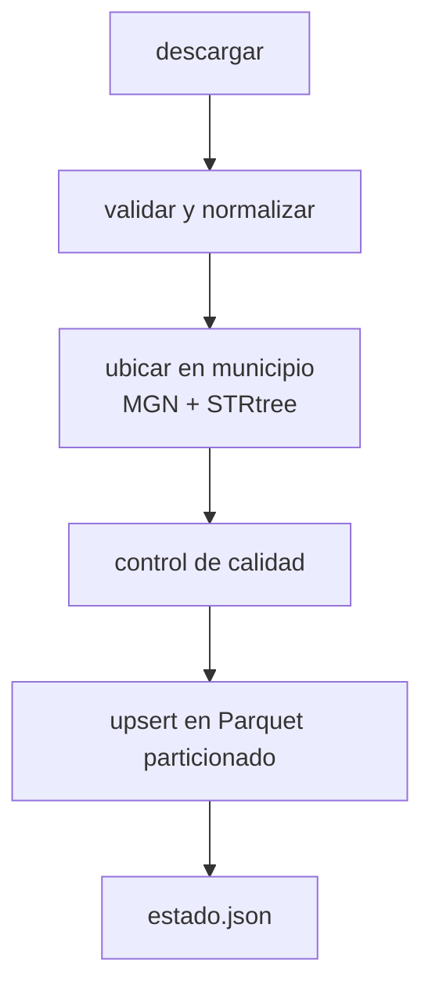

# Arquitectura

## Vista general

Todo es estático y gratuito: no hay servidores ni bases de datos que mantener. GitHub Actions hace el trabajo pesado una vez al día y el navegador de cada visitante consulta los archivos Parquet ya preparados.

## Pipeline (`pipeline/`)

Cada fuente es una clase que hereda de `Source` (`sources/base.py`) y expone un único método `run(ctx)`. El contexto le entrega el cliente HTTP, el directorio de datos, la hora en Colombia y, si se pidió, una fecha de recarga histórica.

| Módulo | Responsabilidad |
|---|---|
| `http.py` | Cliente con reintentos exponenciales y un User-Agent que identifica al proyecto |
| `storage.py` | Escritura atómica y *upsert* por llave en Parquet particionado por mes o año |
| `geo.py` | Asigna cada punto a su código DIVIPOLA con un índice espacial (STRtree de Shapely) |
| `status.py` | Manifiesto con estado, cobertura y fecha de último cambio de cada fuente |
| `cli.py` | `observatorio list · run · status` |

Una fuente que falla no detiene a las demás. Su error queda en `estado.json`, se conserva la última cobertura conocida y el workflow termina en rojo para que GitHub avise por correo.

## Decisiones

**Parquet en vez de CSV o una base de datos.** Es columnar, comprimido (zstd) y tipado. DuckDB-WASM lo lee directamente en el navegador, así que no hace falta un backend.

**Particiones por mes o año.** Las actualizaciones diarias solo reescriben la partición del mes en curso; los meses cerrados no cambian.

**Rama `data` con un solo commit.** Cada día el workflow reemplaza el commit de esa rama en lugar de agregar uno nuevo. El histórico vive dentro de los Parquet, no en git, y el repositorio no crece con el tiempo. Ese push diario también cuenta como actividad, lo que evita que GitHub desactive el cron tras 60 días sin cambios.

**Ventanas de re-descarga.** Las entidades corrigen datos después de publicarlos. Por eso el IDEAM se vuelve a pedir desde 3 días antes del último dato y el USGS desde 30 días antes. El *upsert* reemplaza los valores corregidos.

**Agregación en el servidor del IDEAM.** En lugar de bajar millones de lecturas de 10 minutos, la consulta SoQL entrega directamente el resumen por estación y día, en bloques de 7 días.

**Control de calidad sin borrar datos.** Los datos crudos del IDEAM incluyen sensores dañados. Cada día lleva una columna `qc` con `ok` o el motivo por el que es sospechoso:

| Regla | Criterio |
|---|---|
| `sensor_en_cero` | mínima y máxima del día exactamente en 0 °C |
| `no_coincide_con_altitud` | la media del día se aleja más de 8 °C de la esperada para la altitud de la estación (28,5 − 5,56 °C por km, ajuste con las normales 1991-2020 del IDEAM) |
| `rango_diario_anormal` | más de 25 °C entre la mínima y la máxima del día |
| `acumulado_anormal` | más de 400 mm de lluvia en un día |

**Capa de municipios incluida en el paquete.** El geoportal del DANE corta las conexiones que vienen de centros de datos en la nube (como los de GitHub Actions) y el servicio del IGAC tarda cerca de un minuto por página. Por eso el paquete trae una copia comprimida del MGN 2024 (660 KB). La fuente `mgn-municipios` solo intenta renovarla cada 30 días y, si falla, deja un aviso sin detener a las demás fuentes.

**Solo IPv4.** Los runners de GitHub Actions no tienen salida por IPv6, y algunos servidores (NASA FIRMS) anuncian direcciones IPv6. El cliente HTTP fuerza IPv4 para no perder tiempo en conexiones que nunca responden.

**Ubicación por geometría, no por nombre.** Los nombres de municipio varían entre entidades («Bogotá D.C.», «BOGOTA, D.C.», «Santafé de Bogotá»). Todos los puntos se ubican con los polígonos del MGN, que devuelven el código DIVIPOLA.

**Hora de Colombia.** El pipeline trabaja en UTC-5. Los días del IDEAM son días locales y el día en curso nunca se publica porque está incompleto.

**Sin analista con IA por ahora.** En un sitio público, cada pregunta a un modelo de lenguaje tiene costo. Queda como fase opcional.

## Web (`web/`, fase 3)

React + TypeScript + Vite, MapLibre GL para mapas, deck.gl para 3D y DuckDB-WASM para consultas. El sitio se reconstruye y despliega cuando cambian los datos.
